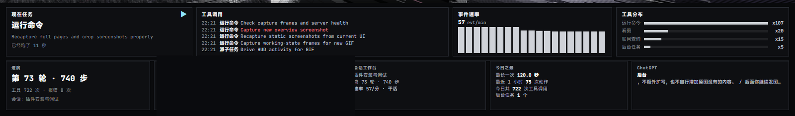
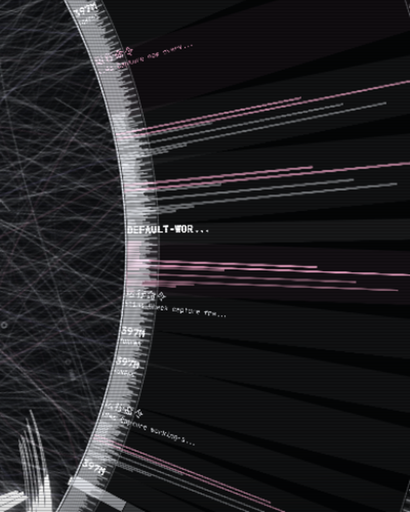

# DSH × HALOFLUX — 实时联动桌面壁纸

**中文** | [English](README.en.md)

把 [HALOFLUX](https://github.com/Ryder191/haloflux)（单文件 Canvas 科幻可视化）接到本机 **DeepSeek Harness** 的真实会话数据上：
轮盘转速、光束爆发、面板数字全由真实事件驱动——空闲时慢速待命，干活时爆发。

同时把**多个 AI 平台**（DeepSeek Harness / MiniMax Code / WorkBuddy / Claude Code / 豆包）的
真实会话数据接进同一画面，谁在干活、谁在思考、谁在空闲一目了然；再把**本机播放器**
（QQ 音乐 / Spotify / 豆包 / B 站…任何接入 Windows SMTC 的播放器）和
**外部 AI 桌面应用**状态接进同一画面，最终作为 **Lively Wallpaper** 的桌面壁纸常驻。

> ⚠️ HALOFLUX 采用 **PolyForm Noncommercial** 许可：**仅限个人非商业使用**，详见 [NOTICE.md](NOTICE.md)。


*五个 AI 平台同时干活的实况：圆环右侧的标题卡片按活跃度层叠（最近操作的浮在最前、其余逐层缩小压暗），
底部「现在任务」滚动带并行显示各平台任务，右下实时事件速率 52 evt/min。*

## 特性

### 数据联动
- **真实数据驱动**：事件速率 → 环带转速；每次工具调用 → 一次真实光束爆发；报错 → 闪光变密
- **5 个数据源**：DeepSeek Harness / MiniMax Code / WorkBuddy / Claude Code / 豆包，
  各自独立读会话日志归一成同一套事件词汇（turn / step / tool / message）
- **空闲待命**：无事件时降为慢速漂移（10% 时间轴），不空转
- **人话面板**：现在任务 / 进度 / 工具调用 / 会话工作台 / 今日之最 / 事件速率 / 工具分布
- **多平台并发可视化**：顶部多卡标题堆叠（谁最活跃谁的卡浮最前，其余缩小压暗），
  底部「现在任务」渐变滚动带（第一行全亮、往下逐层变暗、上下边缘渐隐无缝循环）
- **用量费用**：今日 tokens、花费、余额、缓存命中、峰谷剩余（读 `dsh-cost-meter` 账本）
- **路径脱敏**：面板与截图上的文件路径只显示末两段，用户名自动打码，不外泄本机结构

### 外部 AI 联动
- **四家桌面 AI 状态**：ChatGPT / WorkBuddy / MiniMax Code / 豆包，经 UI Automation 读取窗口与界面文本
- **按身份染色**：每家一个专属色（ChatGPT 薄荷绿 / WorkBuddy 天蓝 / MiniMax 紫罗兰 / 豆包 桃粉 / DSH 冷白）
- **运行即亮、未运行即灰**：颜色代表"是谁"，明暗代表"活没活着"，一眼分辨谁在干活
- **环带也染色**：每个正在运行的外部 AI 在圆环上占一张身份色数据卡

### 播放器
- **系统媒体会话（SMTC）**：读任何播放器，含 QQ 音乐 / Spotify / 豆包 / B 站等
- **可控制**：上一首 / 播放暂停 / 下一首；面板可收起

### 壁纸适配
- **一键安装**：自动装 Lively、注入壁纸工程、设壁纸、写自启、启动服务、对齐屏幕
- **自动选屏**：优先 iPad（spacedesk 虚拟屏），否则主屏；插拔显示器不用手动改编号
- **任务栏安全边距**：自动测量任务栏高度，底部面板精确留出「任务栏 + 1px」
- **高分屏清晰**：DPR 对齐物理像素，杜绝细线模糊与摩尔纹
- **环内文字**：实心黑底 + 整数像素对齐 + 27px 大字，光束再密也不被压

### 并发可视化细节

**多卡标题堆叠** —— 每个活跃平台一张浮动标题卡，谁最近操作谁浮最前（全亮原尺寸），
其余按活跃度逐层缩小、平移、压暗，形成纵深：


*上图：MiniMax Code（最前·全亮）→ DEFAULT-WORKSPACE / DSH（中景·思考中）→ WorkBuddy（背景·最暗），
三张卡片同时在场，一眼看清谁冲在最前面。*

**现在任务渐变滚动带** —— 底部面板并行显示各平台实时任务，第一行全亮、往下逐层变暗，
上下边缘渐隐、无缝循环滚动：


*上图：「现在任务」面板显示 MiniMax 正在「思考中」，话题「提炼设计规范：色彩、字体、间距、组件、图标」，
多平台任务在带内滚动轮播。*





## 快速开始

**一键安装**（推荐，自动处理所有依赖）：

```powershell
powershell -NoProfile -ExecutionPolicy Bypass -File dsh-hud\install.ps1
```

装完即可看到桌面壁纸。预览地址：<http://127.0.0.1:7788/>

**前置条件**：Windows 10/11 x64 + [DeepSeek Harness](https://github.com/Ryder191/haloflux)。
Node.js 与 Lively 缺了会自动装。详见 [INSTALL.md](INSTALL.md)。

## 丢画面？快速找回

切屏 / 插拔显示器 / 系统睡眠唤醒后，偶发壁纸「没了」——本质是 Lively 把壁纸画到了
失活的屏上，或 WebView 被暂停。不用重装，一键拉起：

```powershell
# 双击也行：dsh-hud\recover-wallpaper.cmd
dsh-hud\recover-wallpaper.cmd        # 重载 + 重新选屏 + 打开浏览器预览
dsh-hud\recover-wallpaper.cmd /silent  # 开机静默版：不弹浏览器、不暂停
```

脚本会依次：① 检查 7788 数据服务；② **检查 Lively 宿主进程，没跑就自动启动并等待就绪**（起不来就退出，不空转）；
③ `setwp --file reload` 强制重载（重注入 bridge.js）；④ 跑 `fix-wallpaper-screen.ps1`
重新选屏 + 对齐任务栏；⑤ 顺手跑 `clean-orphan-webviews.ps1` 回收本次 reload 泄漏的播放器；⑥（交互模式）开浏览器预览。

Lively 位置不写死：优先 `HALOFLUX_LIVELY_EXE` 环境变量，其次常见安装目录，再查注册表卸载项。

> 实测坑点：退出 DSH 时偶尔会连 **Lively 宿主进程**一起带走（此时 7788 服务仍活着、
> 壁纸布局也还在，只是没人在画）。所以恢复脚本必须先确保 Lively 在跑，光 reload 是修不好的。
>
> ⚠️ **reload 是有代价的**：它会把播放器撕掉重建，泄漏一个杀不掉的 GPU 进程（2~3.5 GB）。
> 所以除这个脚本外，**没有任何地方会自动 reload**——别把它挂进定时任务。

已注册**登录自启**：`recover-wallpaper-startup.vbs` 在 `shell:startup` 里以 `/silent` 运行，
重启后自动重载 + 重新选屏，覆盖多屏重连导致的丢画面，且不弹浏览器。

**Lively 壁纸观察者（只记录，不自动恢复）**：`watch-lively.vbs`（v3）每 60 秒检查三类信号，
命中只写日志、**绝不自动恢复**：
① `Lively.exe` 进程没了；② `WallpaperLayout.json` 内容变了（插拔/切换显示器）；
③ `/stats` 连续 3 轮 `clients:0`（壁纸页没连上 SSE）。
事件写 `dsh-hud/lively-watch.log`（超 64 KB 轮转）。`watch-lively-startup.vbs` 在
`shell:startup` 里负责登录时拉起。

> **⚠️ 为什么不再自动恢复（2026-11-06 本机实测）**：每次 `setwp --file reload` 都不是软刷新，而是把
> 当前 WebView2 播放器**撕掉重建**（Lively 日志三行连发：`Cleared watchdog` → `Setting wallpaper` →
> `Wv<N>: Process exited with exit code: -1`）。被撕掉的播放器留下一个 GPU 子进程，攥着
> 2~3.5 GB 提交内存，`Handles=2`，**Stop-Process / taskkill / WMI 全杀不掉，只有重启能回收**。
> 本机实测 37 分钟内这样重建了 7 次（Wv20→Wv27），提交内存顶到 47.9/49 GB，
> 最后 `msedgewebview2` 以 `0xE0000008`（OOM）崩溃。**自动恢复在制造它想修的故障。**
> 所以恢复现在只有人工入口：双击 `recover-wallpaper.cmd`。
> 改完守护脚本**需重新登录或重启守护**才生效（VBS 是一次性解释执行）。
想立刻生效：双击 `dsh-hud/watch-lively.vbs`；停用：删掉 Startup 里的
`watch-lively-startup.vbs` 并结束对应的 `wscript.exe` 进程。

## 卸载

```powershell
powershell -NoProfile -ExecutionPolicy Bypass -File dsh-hud\install.ps1 -Uninstall
```

## 目录

| 路径 | 说明 |
|---|---|
| `dsh-hud/server.mjs` | 数据服务：5 源会话增量解码、SSE、媒体/外部 AI/用量代理 |
| `dsh-hud/minimax-source.mjs` | MiniMax Code 数据源（JSONL + sqlite） |
| `dsh-hud/workbuddy-source.mjs` | WorkBuddy 数据源（JSONL + workbuddy.db） |
| `dsh-hud/claude-source.mjs` | Claude Code 数据源（JSONL transcripts） |
| `dsh-hud/doubao-source.mjs` | 豆包数据源（UIA 快照） |
| `dsh-hud/bridge.js` | 注入 HALOFLUX 的桥：联动、面板、多卡堆叠、滚动带、中文化、身份染色、路径脱敏 |
| `dsh-hud/external.ps1` | 外部 AI 状态（UI Automation，五家通用探测） |
| `dsh-hud/media.ps1` | 系统媒体会话读写（上下曲/播放暂停） |
| `dsh-hud/fix-wallpaper-screen.ps1` | 自动选屏 + 任务栏安全边距 |
| `dsh-hud/recover-wallpaper.cmd` | 丢画面快速恢复（重载壁纸 + 重新选屏 + 预览，`/silent` 供开机静默） |
| `dsh-hud/watch-lively.vbs` | Lively 宿主观察者（v3，只记录不自动恢复）：每 60 秒探活，事件写 `lively-watch.log` |
| `dsh-hud/screenshot.mjs` | Edge headless + CDP 高端截图工具 |
| `dsh-hud/wall-proj/` | Lively / Wallpaper Engine 壁纸工程 |
| `dsh-hud/install.ps1` | **一键安装**（依赖 + 壁纸 + 自启 + 服务 + 选屏） |
| `dsh-hud/uninstall.ps1` | 卸载（停服务 + 撤壁纸 + 删自启） |
| `dsh-hud/verify-after-reboot.ps1` | 重启后自检 |
| `haloflux/` | HALOFLUX 原始视觉（未改动，服务端运行时注入 bridge） |

## 架构

```
~/.dsh/sessions/<workspace>/session-*.jsonl.zstd
~/.minimax/... · ~/.workbuddy/... · ~/.claude/projects · doubao UIA
        │ 每 500ms 增量解码（多帧 zstd / jsonl）
        ▼
dsh-hud/server.mjs  (127.0.0.1:7788)  ← 5 个 source 适配器归一事件
        │ SSE /stream · JSON /state /usage /media /external /probe
        ▼
haloflux/lab.html + 运行时注入 bridge.js
        │ setParam() / onBeat() 驱动内部参数；多卡堆叠 / 滚动带
        ▼
Lively Wallpaper（WebView2）→ 桌面壁纸
```

**外部 AI 探针**：`server.mjs` 每 3 秒调用 `external.ps1` → UI Automation 枚举窗口 →
读取状态与界面文本 → 通过 `/external` 供面板与环带消费。

## 配置

常改参数都在 `dsh-hud/bridge.js` 顶部或对应小节：

| 参数 | 位置 | 作用 |
|---|---|---|
| `LOAD` | 约 604 行 | 壁纸模式整体负载（默认 0.50，调低更省） |
| `quality` 上限 | 约 679 行 | 细节密度（默认 0.7） |
| 帧预算 | 约 665 行 | 活跃时帧率（默认 20+40ms，约 50fps 上限） |
| `AGENT_COLOR` | 身份色表 | 各 AI 专属颜色 |
| `--taskbar-safe` | 自动测量 | 任务栏安全边距（默认任务栏+1px） |

改完执行重载即可生效（服务端每请求重读 bridge.js）：

```powershell
& "C:\Program Files\Lively Wallpaper\Lively.exe" setwp --file reload
```

## 性能（本机实测）

| 场景 | CPU | 显存/内存 |
|---|---|---|
| 数据服务 | ≈0.3% 单核 | 60–110 MB |
| 壁纸 · 待命 | ≈4% 单核 | ≈1.0–1.2 GB |
| 壁纸 · 工作中 | ≈30–41% 单核 | ≈1.2–1.3 GB |

> **显存提示**：壁纸本身用 2D canvas（CPU 渲染），GPU 占用很小。
> 若发现显存异常占用，多半是 Lively 库中其他壁纸的动画预览，重启 Lively 可释放。

## 常见问题

| 现象 | 处理 |
|---|---|
| 壁纸黑屏 / 显示"等待 dsh-hud 服务" | 排查 `dsh-hud/start.ps1`；端口被占会直接退出 |
| 退出 DSH 后壁纸消失 | 通常是 **Lively 宿主进程**被带走（7788 服务仍活着）；双击 `recover-wallpaper.cmd`，它会自动重启 Lively + 重载 + 重新选屏 |
| 壁纸跑到别的显示器 | 跑 `fix-wallpaper-screen.ps1` 或双击 `recover-wallpaper.cmd` 重新选屏 |
| 切屏 / 插拔显示器后整个画面没了 | 双击 `dsh-hud/recover-wallpaper.cmd`（重载 + 重新选屏 + 开预览）；观察者会把现场写进 `lively-watch.log`，但不会自动恢复 |
| `WallpaperLayout.json` 里有 `isStale:true` 的失活屏记录 | Lively 为"显示器重新插回"保留的正常配置；真问题是旧选屏脚本按 `Index` 清理，而失活屏与目标屏 Index 都是 1 → 永远清不掉。已改为 `closewp -1` 全清 + `setwp` 重建 |
| 底部面板被任务栏遮住 | 安全边距自动测量；异常时重载壁纸 |
| 内存/提交内存持续上涨直到崩（0xE0000008 OOM） | 每次 `setwp --file reload` 会遗弃一个杀不掉的 WebView2 GPU 进程（2~3.5 GB/次）；不要自动 reload，手动恢复后跑 `clean-orphan-webviews.ps1`，必要时重启回收 |
| 画面卡顿 | 调低 `LOAD`、帧预算或 `quality` |
| 中文显示成方块 | 装 MiSans 字体，或改 `bridge.js` 字体栈 |
| 没有声音 | 正常：壁纸自带 BGM 已硬静音；播放器面板控制的是系统音乐软件 |

## 许可

- 视觉：HALOFLUX by Ryder191，PolyForm Noncommercial（**禁止商业用途**）
- 二次开发脚本：MIT（见 `LICENSE-MIT`），分发请保留非商业性质与署名

## 致谢

- [HALOFLUX](https://github.com/Ryder191/haloflux) by Ryder191 — 视觉本体
- [Lively Wallpaper](https://github.com/rocksdanister/lively) by rocksdanister — 壁纸宿主
- [DeepSeek Harness](https://github.com/DeepSeek-Harness) — 数据源
