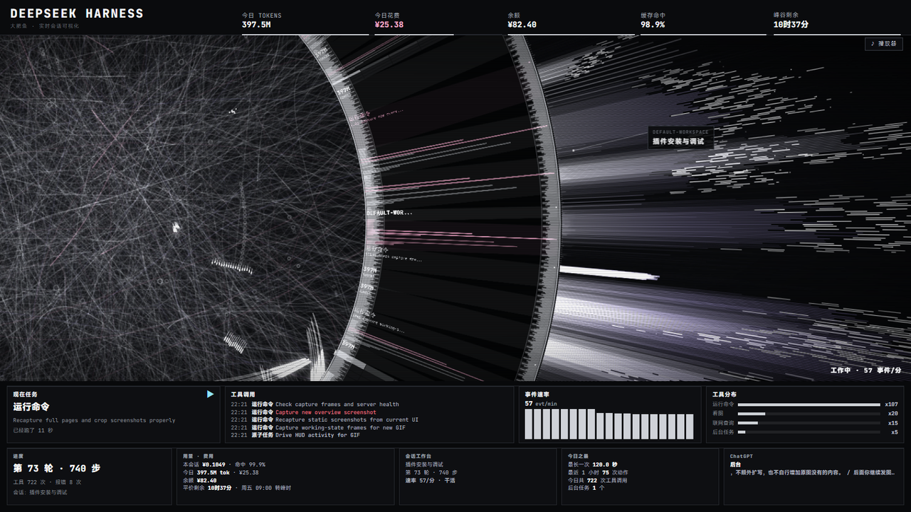

# DSH × HALOFLUX — 实时联动桌面壁纸

**中文** | [English](README.en.md)

把 [HALOFLUX](https://github.com/Ryder191/haloflux)（单文件 Canvas 科幻可视化）接到本机 **DeepSeek Harness** 的真实会话数据上：
轮盘转速、光束爆发、面板数字全由真实事件驱动——空闲时慢速待命，干活时爆发。

同时把**本机播放器**（QQ 音乐 / Spotify / 豆包 / B 站…任何接入 Windows SMTC 的播放器）和
**外部 AI 桌面应用**（ChatGPT / WorkBuddy / MiniMax / 豆包）状态接进同一画面，
最终作为 **Lively Wallpaper** 的桌面壁纸常驻。

> ⚠️ HALOFLUX 采用 **PolyForm Noncommercial** 许可：**仅限个人非商业使用**，详见 [NOTICE.md](NOTICE.md)。



*运行中：环带加速、光束爆发、面板实时刷新。右下「外部 AI」运行中的亮色、未运行的灰暗，谁在工作一目了然。*

## 特性

### 数据联动
- **真实数据驱动**：事件速率 → 环带转速；每次工具调用 → 一次真实光束爆发；报错 → 闪光变密
- **空闲待命**：无事件时降为慢速漂移（10% 时间轴），不空转
- **人话面板**：现在任务 / 进度 / 工具调用 / 会话工作台 / 今日之最 / 事件速率 / 工具分布
- **用量费用**：今日 tokens、花费、余额、缓存命中、峰谷剩余（读 `dsh-cost-meter` 账本）

### 外部 AI 联动
- **四家桌面 AI 状态**：ChatGPT / WorkBuddy / MiniMax Code / 豆包，经 UI Automation 读取窗口与界面文本
- **按身份染色**：每家一个专属色（ChatGPT 薄荷绿 / WorkBuddy 天蓝 / MiniMax 紫罗兰 / 豆包 桃粉 / DSH 冷白）
- **运行即亮、未运行即灰**：颜色代表"是谁"，明暗代表"活没活着"，一眼分辨谁在干活
- **环带也染色**：每个正在运行的外部 AI 在圆环上占一张身份色数据卡

### 播放器
- **系统媒体会话（SMTC）**：读任何播放器，含 QQ 音乐 / Spotify / 豆包 / B 站等
- **可控制**：上一首 / 播放暂停 / 下一首；面板可收起

### 壁纸适配
- **一键安装**：自动装 Lively、注入壁纸工程、设壁纸、写自启、启动服务、对齐屏幕
- **自动选屏**：优先 iPad（spacedesk 虚拟屏），否则主屏；插拔显示器不用手动改编号
- **任务栏安全边距**：自动测量任务栏高度，底部面板精确留出「任务栏 + 1px」
- **高分屏清晰**：DPR 对齐物理像素，杜绝细线模糊与摩尔纹
- **环内文字**：实心黑底 + 整数像素对齐 + 27px 大字，光束再密也不被压


## 快速开始

**一键安装**（推荐，自动处理所有依赖）：

```powershell
powershell -NoProfile -ExecutionPolicy Bypass -File dsh-hud\install.ps1
```

装完即可看到桌面壁纸。预览地址：<http://127.0.0.1:7788/>

**前置条件**：Windows 10/11 x64 + [DeepSeek Harness](https://github.com/Ryder191/haloflux)。
Node.js 与 Lively 缺了会自动装。详见 [INSTALL.md](INSTALL.md)。

## 卸载

```powershell
powershell -NoProfile -ExecutionPolicy Bypass -File dsh-hud\install.ps1 -Uninstall
```

## 目录

| 路径 | 说明 |
|---|---|
| `dsh-hud/server.mjs` | 数据服务：会话增量解码、SSE、媒体/外部 AI/用量代理 |
| `dsh-hud/bridge.js` | 注入 HALOFLUX 的桥：联动、面板、中文化、壁纸模式、身份染色 |
| `dsh-hud/external.ps1` | 外部 AI 状态（UI Automation，四家通用探测） |
| `dsh-hud/media.ps1` | 系统媒体会话读写（上下曲/播放暂停） |
| `dsh-hud/fix-wallpaper-screen.ps1` | 自动选屏 + 任务栏安全边距 |
| `dsh-hud/wall-proj/` | Lively / Wallpaper Engine 壁纸工程 |
| `dsh-hud/install.ps1` | **一键安装**（依赖 + 壁纸 + 自启 + 服务 + 选屏） |
| `dsh-hud/uninstall.ps1` | 卸载（停服务 + 撤壁纸 + 删自启） |
| `dsh-hud/verify-after-reboot.ps1` | 重启后自检 |
| `haloflux/` | HALOFLUX 原始视觉（未改动，服务端运行时注入 bridge） |

## 架构

```
~/.dsh/sessions/<workspace>/session-*.jsonl.zstd
        │ 每 500ms 增量解码（多帧 zstd）
        ▼
dsh-hud/server.mjs  (127.0.0.1:7788)
        │ SSE /stream · JSON /state /usage /media /external /probe
        ▼
haloflux/lab.html + 运行时注入 bridge.js
        │ setParam() / onBeat() 驱动内部参数
        ▼
Lively Wallpaper（WebView2）→ 桌面壁纸
```

**外部 AI 探针**：`server.mjs` 每 3 秒调用 `external.ps1` → UI Automation 枚举窗口 →
读取状态与界面文本 → 通过 `/external` 供面板与环带消费。

## 配置

常改参数都在 `dsh-hud/bridge.js` 顶部或对应小节：

| 参数 | 位置 | 作用 |
|---|---|---|
| `LOAD` | 约 604 行 | 壁纸模式整体负载（默认 0.50，调低更省） |
| `quality` 上限 | 约 679 行 | 细节密度（默认 0.7） |
| 帧预算 | 约 665 行 | 活跃时帧率（默认 20+40ms，约 50fps 上限） |
| `AGENT_COLOR` | 身份色表 | 各 AI 专属颜色 |
| `--taskbar-safe` | 自动测量 | 任务栏安全边距（默认任务栏+1px） |

改完执行重载即可生效（服务端每请求重读 bridge.js）：

```powershell
& "C:\Program Files\Lively Wallpaper\Lively.exe" setwp --file reload
```

## 性能（本机实测）

| 场景 | CPU | 显存/内存 |
|---|---|---|
| 数据服务 | ≈0.3% 单核 | 60–110 MB |
| 壁纸 · 待命 | ≈4% 单核 | ≈1.0–1.2 GB |
| 壁纸 · 工作中 | ≈30–41% 单核 | ≈1.2–1.3 GB |

> **显存提示**：壁纸本身用 2D canvas（CPU 渲染），GPU 占用很小。
> 若发现显存异常占用，多半是 Lively 库中其他壁纸的动画预览，重启 Lively 可释放。

## 常见问题

| 现象 | 处理 |
|---|---|
| 壁纸黑屏 / 显示"等待 dsh-hud 服务" | 排查 `dsh-hud/start.ps1`；端口被占会直接退出 |
| 退出 DSH 后壁纸消失 | 用开机自启启动，别从 DSH 会话里手动起服务 |
| 壁纸跑到别的显示器 | 跑 `fix-wallpaper-screen.ps1` 重新选屏 |
| 底部面板被任务栏遮住 | 安全边距自动测量；异常时重载壁纸 |
| 画面卡顿 | 调低 `LOAD`、帧预算或 `quality` |
| 中文显示成方块 | 装 MiSans 字体，或改 `bridge.js` 字体栈 |
| 没有声音 | 正常：壁纸自带 BGM 已硬静音；播放器面板控制的是系统音乐软件 |

## 许可

- 视觉：HALOFLUX by Ryder191，PolyForm Noncommercial（**禁止商业用途**）
- 二次开发脚本：MIT（见 `LICENSE-MIT`），分发请保留非商业性质与署名

## 致谢

- [HALOFLUX](https://github.com/Ryder191/haloflux) by Ryder191 — 视觉本体
- [Lively Wallpaper](https://github.com/rocksdanister/lively) by rocksdanister — 壁纸宿主
- [DeepSeek Harness](https://github.com/DeepSeek-Harness) — 数据源
